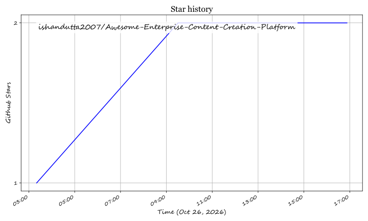

# Awesome-Enterprise-Content-Creation-Platform

## Top Enterprise Content Creation Platform Ecosystem

**Curated List of SaaS Products & Open-Source GitHub Projects**  

*Focused on Branded Content Creation, Design Automation & Digital Asset Management*  

**Last updated: October 2026**

This repository tracks notable **SaaS platforms** and **open-source projects** for **Enterprise Content Creation Platforms**. These tools enable teams to design on-brand marketing assets, automate template-based content generation, manage digital assets, and maintain brand consistency across channels at scale.

**Examples** include Adobe Express Enterprise, Canva Enterprise, Visme Enterprise, Marq, Celtra, Bannerbear, Papirfly, Bynder Content Workflow, Brandfolder Studio, and Frontify Digital Assets (the category leaders).

**Open-source emphasis**: This section is heavily expanded with active projects for self-hosted design editors, brand asset management, template automation, and AI-assisted content creation — ideal for enterprises, marketing teams, and developers building sovereign creative infrastructure.

Contributions welcome! Open a PR to add/update entries. Keep descriptions factual and link to official sites.

## Table of Contents

- [SaaS/Hosted Platforms](#saas-products)

- [Open-Source GitHub Projects](#open-source-github-projects)

- [How to Contribute](#how-to-contribute)

- [Disclaimer](#disclaimer)

## SaaS/Hosted Platforms

- **[Adobe Express Enterprise](https://www.adobe.com/express/enterprise.html)**  

  Enterprise tier of Adobe Express with brand controls, template locking, and Creative Cloud Libraries integration for on-brand content at scale.

- **[Canva Enterprise](https://www.canva.com/enterprise/)**  

  Enterprise design platform with Brand Kit, Brand Controls, approval workflows, and team collaboration for marketing and non-designers.

- **[Visme Enterprise](https://www.visme.co/enterprise/)**  

  Visual content platform for infographics, presentations, and social graphics with brand management and team collaboration features.

- **[Marq](https://www.marq.com/)**  

  Brand templating platform (formerly Lucidpress) for locked templates, approval workflows, and distributed brand consistency.

- **[Celtra](https://celtra.com/)**  

  Creative automation platform for ad production at scale, with dynamic creative optimization and template-based banner generation.

- **[Bannerbear](https://www.bannerbear.com/)**  

  API-first image and video generation service for automated template-based creative production (social images, banners, catalogs).

- **[Papirfly](https://www.papirfly.com/)**  

  Brand activation platform combining brand asset management, template-based content creation, and brand governance.

- **[Bynder Content Workflow](https://www.bynder.com/en/products/content-workflow/)**  

  Content operations platform (formerly Webdam) with DAM, creative workflows, and brand templating for enterprise marketing teams.

- **[Brandfolder Studio](https://brandfolder.com/)**  

  Digital asset management with integrated creative templating, brand portals, and asset distribution for enterprise brands.

- **[Frontify Digital Assets](https://www.frontify.com/en/digital-asset-management/)**  

  Brand management platform combining DAM, brand guidelines, and creative templates for distributed teams.

## Open-Source GitHub Projects

- **[Doory](https://github.com/shaongitbd/doory)**  

  Self-hosted browser-based design editor for posters, social posts, slides, and more; supports templates, animations, brand kits, real-time co-editing, and export to PNG/JPG/SVG/PDF/MP4/GIF with Docker deployment .

- **[HyCanvas](https://github.com/hyscaler/HyCanvas)**  

  AI-native open-source design software for graphics and social posts; ships with a starter brand kit, built-in template catalog, and self-contained binary for Linux and macOS .

- **[Artbucket](https://github.com/pwnera/artbucket)**  

  Self-hosted DAM and brand manager that treats brand assets, rules, rights, and releases as queryable data; exposes MCP, REST API, and CLI for both human and AI agent access .

- **[Open Creative Agent](https://github.com/GML-FMGroup/open-creative-agent)**  

  Multi-agent creative generation system from 光明实验室; takes a text prompt to finished posters, e-commerce image sets, and articles with precise text rendering, runs locally with user-configurable models (Apache-2.0) .

- **[Ignis](https://github.com/danstta/ignis)**  

  Open-source design + automation platform combining template design with workflow automation (Canva + Zapier concept); supports brand management, server-side PNG rendering, and Google Drive/OpenAI/Notion integrations .

- **[Calqo](https://github.com/kilianvivien/calqo)**  

  macOS design app with animation capabilities for social media visuals; supports multi-scene clips, MP4/GIF export, and MCP server for agent-assisted editing .

- **[Vixl](https://github.com/jxburros/Vixl)**  

  Editable image-document engine for AI agents and programmable creative work; create, edit, and export layered designs via MCP, CLI, Python, or REST without a graphical display .

- **[DAM MCP Server](https://github.com/zavora-ai/mcp-dam)**  

  Full Digital Asset Management platform with 23 MCP tools covering ingest, metadata, versions, rights/licensing with clearance gating, brand review, and usage tracking; modeled after Bynder/Brandfolder workflows .

### Additional Strong Open-Source Options

- **[Open-Generative-AI](https://github.com/madrasmillennial/Open-Generative-AI)**  

  Self-hosted AI image and video generation studio with 200+ models (Flux, Kling, Sora, Veo); useful as a backend generation layer for content creation pipelines .

- **Bannerbear-style API tools** — Community projects for template-based image generation via API (e.g., Laravel AI Banner Generator packages) .

- **Brand template automation** — Combine Ignis workflow nodes with Doory or HyCanvas for scheduled, data-driven creative production.

**Frameworks for building custom systems**: Combine **Doory** or **HyCanvas** for the design editor layer, **Artbucket** or **DAM MCP Server** for brand asset governance, **Ignis** for template-to-workflow automation, and **Open Creative Agent** for AI-assisted creative generation in a fully self-hosted enterprise content creation stack.

## How to Contribute

1. Fork the repo.

2. Add/edit entries in `README.md` (follow existing format).

3. Include: name, link, 1–2 sentence description, and whether it's SaaS or open-source.

4. Submit PR with a short explanation.

Star the repo if you find it useful!

## Disclaimer

- This is a **community-curated** list — not exhaustive and not an endorsement.

- Content creation platforms must comply with brand guidelines, licensing terms, and applicable regulations.

- Self-hosted open-source solutions require proper security hardening, asset storage planning, and backup strategies.

- Verify license terms for commercial use, especially for projects using non-standard licenses (e.g., Doory's Attribution Assurance License requires visible credit).

---

**Made for enterprises, marketing teams, brand managers, and creative technologists.**  

Let's make enterprise content creation more open, brand-safe, and scalable.

## Star History

<a href="https://star-history.com/#ishandutta2007/Awesome-Enterprise-Content-Creation-Platform&Timeline" align="center">
  <picture>
    <source media="(prefers-color-scheme: dark)" srcset="assets/ishandutta2007_Awesome-Enterprise-Content-Creation-Platform_growth.svg">
    
  </picture>
</a>
